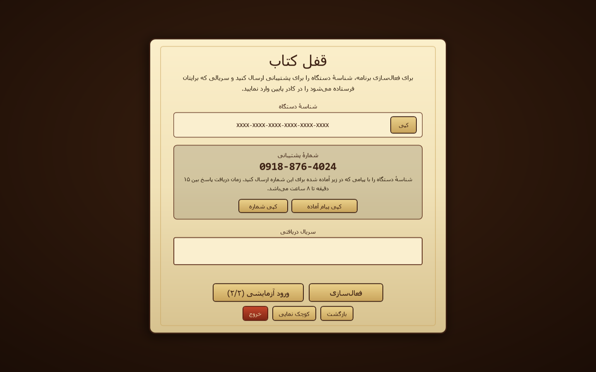
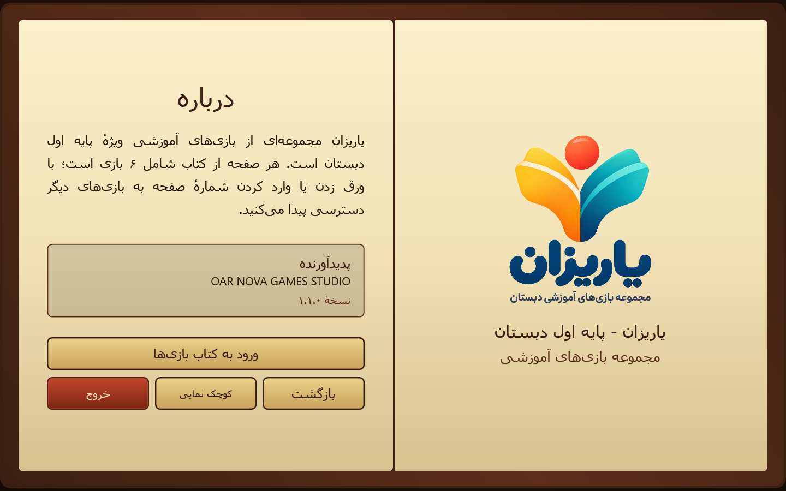
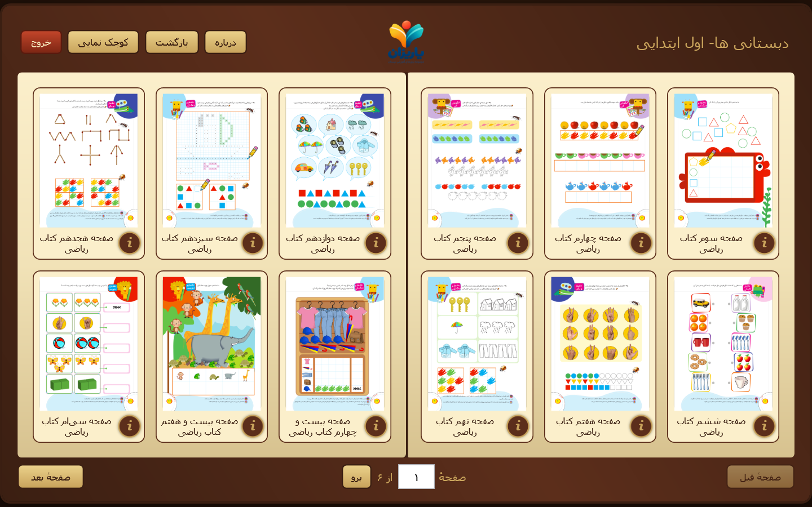

# YariZan: Persian Educational Mini-Games Launcher for Windows 11

### 🔌 PowerShell Setup Button

     

---

YariZan is a Windows desktop launcher that organizes educational mini-games for grades 1 through 6 into a single, cohesive application, presenting its catalog as an ornate leather book with page-turn animation, portrait game tiles, and direct page navigation in Persian, Arabic, or English digits. Each grade ships as its own package with encrypted game bundles, so titles surface from filenames while descriptions remain limited to instructions. The launcher pairs a device to a YariZan account through a browser-based code, grants two trial sessions per device and grade, and unlocks a grade-bound perpetual offline license after purchase, all validated through ES256 signatures and a hardware-locked activation model. Duplicate launches are blocked, and an animated logo loading state displays while each game is prepared, keeping the experience responsive and controlled across the full catalog.

## 🔧 Requirements

- **OS:** Windows 10 / 11
- **Shell:** PowerShell 5.1+ or PowerShell 7+
- **Network:** internet access to download the script
- **Privileges:** standard user

## Features

- Ornate leather-book interface with a portrait two-page spread, three columns and two rows per page, animated page-turn transitions, and direct page navigation accepting Persian, Arabic, or Latin digits.
- Grade-specific packages (grades 1–6), each shipping as a self-contained Windows launcher with its own Persian cover title and catalog, built as x86/x64 binaries with a combined installer.
- Encrypted game bundles decrypted at runtime; catalog titles are derived from filenames and game descriptions expose instructions only, with no source payloads distributed alongside the launcher.
- Hardware-locked activation: each device is bound to a YariZan account through a browser-based pairing code, and a grade-bound perpetual license is issued after purchase for fully offline play.
- Two trial sessions per device and grade, requiring connectivity only at the moment each trial starts; duplicate launches of the same title are detected and blocked.
- Signed license verification using ES256 keys against an offline license root, with automatic activation after checkout and support for revocation.
- Animated YariZan-logo loading overlay while a selected game is prepared, with launch state tracked per title.
- Localized Persian RTL layout throughout the launcher, including cover, information, credits, and game-detail views.
- Standalone special-products catalog for independent titles, each with its own license and trial allocation, decoupled from the grade packages.

## How it works

YariZan operates as a self-contained desktop launcher built on the .NET 9 Windows stack. On startup, the application resolves the local catalog of encrypted game bundles, renders the grade-specific book interface, and validates the installation state before exposing any playable content.

**Catalog assembly.** Titles are derived from the filenames of packed game bundles, while descriptions are restricted to instruction text only. The packer encrypts each game and emits a manifest that the launcher consumes at runtime, so the catalog is rebuilt from local resources without network access. Sorting, pagination, and the two-by-three portrait grid are computed from this manifest, giving each grade package a fixed, deterministic layout.

**Book-style navigation.** The interface presents content as an ornate leather-bound book with animated page turns. Page navigation accepts Persian, Arabic, and Latin digit input, normalizes the value, and jumps directly to the requested spread. Rendering is driven by the WPF view layer, which composes cover artwork, grade titles, and credits from package metadata.

**Activation and trials.** Device identity is established locally and paired to a YariZan account through a browser-based pairing code. Each device and grade combination receives two trial sessions; the network is consulted only when a trial begins. After purchase, the launcher verifies a grade-bound perpetual license signed with ES256 against the embedded public root and permits fully offline play thereafter.

**Launch pipeline.** Selecting a game decrypts the target bundle, displays an animated YariZan-logo loading state, and hands control to the mini-game process. Concurrent launches of the same title are blocked to prevent duplicate instances, and the overlay is dismissed only once the game reports readiness.

**Integrity and release checks.** Commercial builds pass through a release-check stage that rejects test keys, private key material, or an absent activation configuration. License verification, device identity, and cryptographic routines live in the core library, keeping the view layer free of trust decisions and ensuring every playable path is gated by a verified license state.

## Compatibility

YariZan is built and distributed as a Windows desktop application. The launcher targets the `net9.0-windows` framework and ships as a self-contained executable, so the .NET runtime does not need to be installed separately on the target machine. Both x86 and x64 launchers are produced, and a combined installer packages the launcher together with its encrypted game catalog for a single grade.

- **Operating system:** Windows desktop environments supported by the WPF presentation stack. The book-style interface, page-turn animation, and portrait game grid are rendered natively through WPF.
- **Architecture:** x86 and x64 builds are available. The installer selects the appropriate launcher for the host architecture.
- **Runtime:** self-contained deployment; no external framework installation is required.
- **Display:** the launcher is designed for portrait-oriented game artwork arranged in a three-column, two-row page layout. Direct page navigation accepts Persian, Arabic, or English digits.
- **Localization:** the interface is Persian RTL by default, with digit input accepted across Persian, Arabic, and English numeral systems.

Device-bound activation and licensing are handled entirely within the application. Each grade is packaged independently as **YariZan G1**, **G2**, and so on, and each package carries its own grade-bound perpetual offline license after purchase. Two trial sessions per device and grade are available; an internet connection is required only to start each trial, after which gameplay proceeds offline. The device pairing flow uses a browser-based connection code, and duplicate launches of the same title are blocked while a game is being prepared.

Because the installer is not Authenticode-signed, Windows SmartScreen may present an "Unknown publisher" warning during installation. License integrity is enforced independently through YariZan's own ES256 signature verification rather than through operating-system code signing. Game bundles are encrypted, and encrypted catalogs are decrypted at launch time under the device's bound license.

## 📸 Screenshot

## FAQ

**Which Windows versions are supported?**
YariZan targets `net9.0-windows` and ships as a self-contained launcher, so no separate .NET runtime is required on the target machine. Both x86 and x64 launchers are produced. The WPF shell relies on standard Windows presentation and rendering components; systems that lack them or that aggressively restrict unsigned executables may block or degrade the experience.

**Why does Windows SmartScreen warn about the installer?**
The installer is not Authenticode-signed, so SmartScreen may report an "Unknown publisher" warning. This does not affect license integrity: activation records and offline licenses are protected by YariZan's own ES256 signatures and verified locally by the launcher before any game is unpacked. Integrity of the delivered installer can be confirmed by comparing its SHA-256 digest against the published checksum for the corresponding release.

**How does hardware-locked activation work?**
Each installation derives a stable device identity from the host machine. Activation binds a grade-bound perpetual license to that identity. During first-run setup the launcher displays a browser pairing code; entering it connects the device to a customer account, after which purchased licenses are activated automatically and can be used fully offline. Revocation is handled server-side and propagated through the signed license state.

**How many trial sessions are available, and is internet required?**
Every device receives two trial sessions per grade. Connectivity is required only to start each trial session; once a session has begun, gameplay proceeds locally. Trial usage is tracked per device and per grade so that the same hardware cannot reset its trial allowance by reinstalling.

**Can a single license be used on multiple machines?**
Licenses are bound to the device identity captured at activation. Moving a license to different hardware requires the device to be re-paired and the license re-issued through the account. The launcher blocks duplicate concurrent launches of the same title so that a prepared game is never started twice from the same installation.

**Why does a game take a moment to open?**
Game bundles are stored encrypted. When a title is selected, the launcher verifies the license, decrypts and stages the bundle, and displays the animated YariZan-logo loading overlay until preparation completes. This design keeps payloads opaque at rest while preserving fast subsequent launches.

**Which grades and products are packaged together?**
Each grade ships as an independent package named **YariZan G1**, **G2**, and so on, with the Persian cover title following the grade. A package contains only its own grade's catalog: a portrait game book arranged three columns by two rows per page, with page-turn animation and direct page navigation in Persian, Arabic, or English digits. Standalone products under **محصولات ویژه**, such as **عددساز کوچولو**, carry their own separate license and trial allowance and are distributed with their own launchers and combined installer.

**How is catalog content described inside the app?**
Titles are derived from filenames and descriptions present instructional text only; the launcher does not embed marketing copy or external references. Persian RTL layout, grade-specific cover art, and studio credits are rendered by the shell, while the games themselves remain self-contained bundles.

**Does the launcher phone home during normal play?**
No. After activation, verification is performed locally against the signed license and the bound device identity. Network access is used for pairing, trial start, purchase fulfillment, and revocation checks; ordinary offline sessions do not depend on backend availability.

**What happens if a license is revoked or a device is reset?**
The launcher revalidates signed license state whenever connectivity is available. A revoked license stops unlocking its bound grade on the next verification. A reset or significantly altered device identity invalidates the existing binding, and the device must be paired again through the account before a license can be re-issued.

**Are the games modifiable or extractable?**
Game payloads are delivered as encrypted bundles and are decrypted only in memory for execution by the launcher. Local encryption and signed checks raise the cost of tampering but do not make a customer-controlled binary impossible to modify; the security model documents these limits explicitly.

**Where are logs and diagnostic information kept?**
The launcher records activation, trial, and launch events locally to support troubleshooting. These records contain device identifiers in masked form and are intended for support diagnostics; they are not transmitted except as part of the activation and licensing flows described above.

**Can the application run without administrator rights?**
The launcher and its games operate from a per-user installation context and do not require elevated privileges for normal play. Installer-level operations, such as placing shortcuts or registering uninstall information, follow standard per-machine or per-user Inno Setup behavior depending on the chosen install mode.

**Is there a portable or non-installer distribution?**
The published self-contained launcher directory can be run directly, provided the adjacent encrypted games directory is preserved. The installer remains the supported distribution path because it keeps the launcher and its payloads consistent and records the version metadata used by release verification.

**How are updates delivered?**
Each grade package is versioned independently. Updating means installing the newer package for that grade; the bound license remains valid because it is tied to the device identity and grade rather than to a specific build. Release builds are gated by automated checks that refuse test keys, private keys, or missing activation configuration, so shipped packages always carry production licensing parameters.

## Disclaimer

YariZan is an independently developed, proprietary desktop launcher for educational mini-games covering grades 1–6. The software embeds encrypted game bundles, a hardware-bound device identity module, two-session trial gating, and grade-scoped offline license verification based on ES256 signatures rooted in the YariZan license chain. Operation is designed to continue offline after activation, with connectivity required only for device pairing, trial initiation, and license acquisition.

Because the launcher executes on customer-controlled hardware, local encryption and signature verification provide integrity and anti-tamper deterrence, not an absolute technical guarantee. A determined operator with full administrative control over the machine can modify binaries, memory, or storage. YariZan does not claim, and this document does not imply, that license enforcement, trial limits, or bundle confidentiality are resistance-proof against such modification. Integrity checks, duplicate-launch blocking, and signed manifests reduce casual circumvention and misconfiguration, but they cannot make a locally executed program immutable.

The installer is not Authenticode-signed; operating-system trust prompts may therefore display an unknown-publisher warning. This is a distribution characteristic, not an indication of compromise, and does not affect the ES256 license signature model, which is validated independently by the launcher. Users should verify the published SHA-256 checksum of the installer against the value shipped in the corresponding release artifacts before execution.

Trial allowances, license scope, and device binding are enforced per device and per grade. Reimaging, hardware changes, or manual identity manipulation may invalidate paired state and require reconnection or reactivation, which is a deliberate consequence of hardware-locked activation rather than a defect. The trial is intended for evaluation only; continued use beyond the trial period requires a valid perpetual license for the corresponding grade or standalone product.

Game content, fonts, and third-party assets distributed alongside YariZan remain subject to their own respective licenses, and compliance with those terms is the responsibility of the distributor and the end user. Localization and RTL presentation do not alter underlying asset licensing obligations.

YariZan is provided on an "as is" basis, without warranties of merchantability, fitness for a particular purpose, or non-infringement, to the maximum extent permitted by applicable law. In no event shall the authors or rights holders be liable for indirect, incidental, special, or consequential damages, or for loss of data, revenue, or educational outcomes, arising from use or inability to use the software, even if advised of the possibility of such damages. Nothing in this section limits rights that cannot be limited under mandatory local law.

This disclaimer applies to all builds, including trial and licensed editions, and to any standalone products distributed under the YariZan catalog.

## License

YariZan is proprietary software distributed under the bilingual end-user license agreement shipped with the product. The agreement governs installation, activation, and use of the launcher and its bundled game content; it is presented during setup and is available for review before activation is completed.

The license model is technical rather than nominal. Each package is bound to a single grade and activated through hardware-locked device identity: a device connects to a YariZan account via a browser pairing code, receives two trial sessions per device and grade, and converts to a grade-bound perpetual offline license after purchase. License artifacts are protected by ES256 signatures verified locally against the embedded license root, so validity is checked without a network round trip and the software continues to function offline once activated. Trial sessions require connectivity only at the moment each trial is started.

Redistribution is not permitted. The installer, encrypted game bundles, license signing material, and activation configuration may not be copied, repackaged, or distributed outside the terms of the agreement. Decryption keys and private signing keys are never included in customer builds, and commercial builds run release checks that reject test keys, private keys, or a missing activation configuration. Game and font assets bundled with YariZan remain subject to their respective upstream licenses, which take precedence for those components.

Local encryption and signed checks raise the cost of tampering but do not make a customer-controlled binary impossible to modify; the security documentation describes these limits in detail. The license grants no rights beyond those expressly stated in the agreement, and all rights not granted are reserved by the studio.